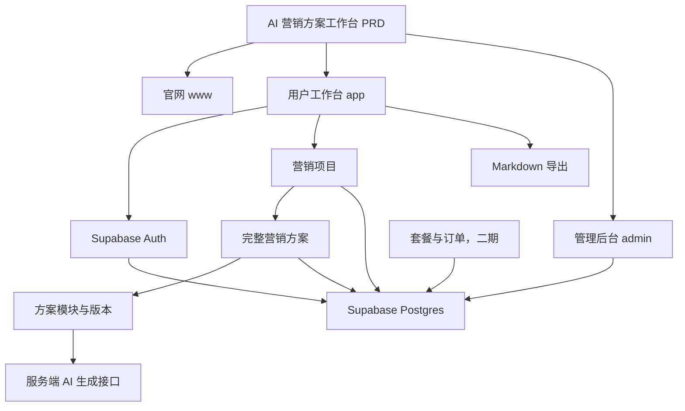
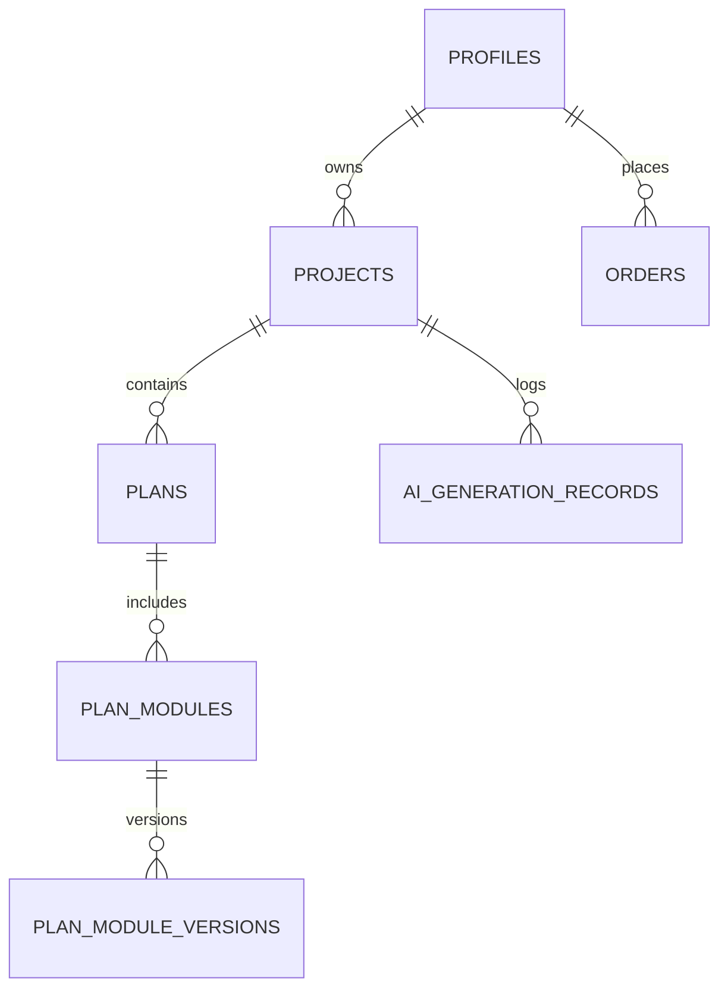

# AI 营销方案工作台开发实战

> 基于 [PRD.md](./PRD.md) 编写。教程结构参考 [Easy Vibe 的 AI 营销文案 SaaS 开发实战](https://datawhalechina.github.io/easy-vibe/zh-cn/stage-2/assignments/copywriting-platform-supabase/)，但所有页面、数据模型、提示词和验收标准均已改为本项目的 AI 营销方案工作台。

## 概述

本教程带你从一份产品需求文档出发，完成一个面向市场策划、品牌负责人和营销服务商的 AI 营销方案工作台。

它不是一个“输入一句话，生成一段文案”的工具。用户围绕一个营销项目持续补充资料，生成完整营销方案，并对方案中的策略、渠道、内容、排期、预算和指标逐模块修改、保存版本与导出。

本教程的最终产品包含三个入口：

| 入口 | 子域名建议 | 核心职责 |
| --- | --- | --- |
| 官网 | `www.xxx.com` | 产品介绍、定价、FAQ、引导注册 |
| 用户工作台 | `app.xxx.com` | 创建营销项目、生成方案、编辑模块、查看历史、导出 |
| 管理后台 | `admin.xxx.com` | 查看用户、项目、生成量、订单和模型用量 |

技术建议：Next.js App Router + Supabase Auth / Postgres / Storage + 服务端 AI 接口。MVP 阶段可先使用本地假数据完成页面和交互，再逐步接入后端能力。

## 前置知识

开始前，建议先具备以下基础：

1. 知道如何运行一个 React 或 Next.js 项目。
2. 了解组件、路由、表单和基础状态管理。
3. 会创建 Supabase 项目和配置环境变量。
4. 知道 API Key 只能放在服务端环境变量中，不能写到浏览器代码里。
5. 会用 Git 保存阶段性成果。

## 学习目标

完成本教程后，你应该可以：

1. 从 PRD 拆出页面、数据表、接口和验收标准。
2. 用 AI 分步骤搭建现代 SaaS 风格的官网、用户工作台和后台。
3. 用 Supabase 实现登录、项目、方案、模块版本和生成记录。
4. 通过后端调用模型，生成完整营销方案和模块级改写结果。
5. 实现历史记录、Markdown 导出、套餐限制和管理员访问控制。
6. 完成从注册、创建项目到方案生成、导出和后台查看的端到端验证。

## 项目边界

第一版的目标是跑通真实的“项目 → 方案 → 修改 → 保存 → 导出”闭环。不要一开始做多人协作、模板市场、竞品抓取和完整 PPT 自动排版。

| MVP 必做 | 后续增强 |
| --- | --- |
| 项目创建与保存 | 多人协作与评论 |
| 完整方案生成 | 品牌资料库与模板市场 |
| 模块化编辑与 AI 修改 | PDF / Word / PPT 高级导出 |
| 历史项目与版本 | 自动竞品数据抓取 |
| Markdown 导出 | 复杂审批工作流 |
| 基础登录和权限 | 多模型路由与用量结算 |

---

# 第一部分：需求分析

## 1.1 阅读 PRD

先打开 [PRD.md](./PRD.md)。在开始写代码前，确认下面的问题都有明确答案：

1. 产品的核心产出是什么？
2. 用户围绕什么对象工作？
3. 一个完整营销方案包含哪些模块？
4. 哪些页面属于官网，哪些页面属于用户工作台和后台？
5. 一期要做哪些能力，哪些能力只能放到后续版本？
6. 用户、项目、方案、模块版本和生成记录之间是什么关系？

本项目的关键答案如下：

| 问题 | 本项目答案 |
| --- | --- |
| 核心产出 | 一份可执行的完整营销方案，而不是单条文案 |
| 核心工作对象 | 营销项目 |
| 方案组成 | 市场与机会、目标人群、目标、策略、渠道、内容、排期、预算、指标、风险等模块 |
| 核心用户 | 市场策划、品牌负责人、运营人员、创业团队和营销服务商 |
| MVP 主链路 | 创建项目 → 生成方案 → 修改模块 → 保存版本 → 导出 Markdown |
| 二期能力 | 支付、模板库、团队协作、复杂导出、完整运营后台 |

> 如果上述答案仍有模糊处，先修改 PRD，再做页面。需求不清楚时开始写代码，通常只会把返工提前埋进去。

## 1.2 明确系统架构



## 1.3 本阶段交付物

完成需求分析后，项目中至少应有：

1. `PRD.md`：产品需求原文。
2. `AI营销方案工作台-开发教程.md`：本教程。
3. 页面清单、数据表清单、接口清单和 MVP 范围的明确结论。

---

# 第二部分：搭建项目与前端骨架

## 2.1 初始化项目

推荐使用 Next.js App Router。创建项目后，先建立与三个入口对应的路由分组：

```text
app/
  (www)/
    page.tsx
    pricing/page.tsx
    faq/page.tsx
  (app)/
    login/page.tsx
    register/page.tsx
    projects/page.tsx
    projects/new/page.tsx
    projects/[projectId]/page.tsx
    projects/[projectId]/plans/[planId]/page.tsx
    history/page.tsx
    billing/page.tsx
  (admin)/
    admin/page.tsx
    admin/users/page.tsx
    admin/generations/page.tsx
    admin/orders/page.tsx
```

如果暂时不做子域名，可以先使用路径区分：`/www`、`/app` 和 `/admin`。功能稳定后，再在网关或托管平台中把子域名重写到对应路径。

## 2.2 生成全部页面骨架

把以下提示词发给你的编程助手。先只生成页面、路由、组件和假数据，不接入真实数据库、模型或支付。

```text
请基于当前 PRD，帮我生成一个 AI 营销方案工作台的前端骨架。

产品不是单条文案生成器。它以“营销项目”为核心，用户填写项目背景后生成完整营销方案，并能按模块继续编辑和让 AI 修改。

要求：
1. 分成三个入口：www、app、admin，可先用 /www、/app、/admin 路由模拟。
2. 官网包括：首页、定价、FAQ。
3. app 包括：登录、注册、项目工作台、创建项目、项目详情、方案编辑、历史记录、套餐页。
4. admin 包括：后台首页、用户管理、项目与生成记录、支付订单。
5. 先只生成页面结构和假数据，不接真实接口。
6. 方案编辑页需使用“三栏布局”：左侧方案目录，中间模块正文，右侧 AI 修改面板。
7. 项目工作台要展示最近项目、项目状态、快速创建入口和空状态。
8. 风格像真实的现代 B2B SaaS：信息层级清楚、数据密度适中、响应式可用，不要做成课堂 demo 或营销海报。
9. 使用项目中已有的组件库和图标库；如果没有，请说明需要安装的依赖后再使用。
```

## 2.3 完善项目创建页

项目创建页决定生成质量。表单按信息组分段，不要堆成一张很长的问卷。

```text
请继续完善 /app/projects/new 页面。

这是 AI 营销方案工作台的新建项目页。请实现多分组表单和本地 mock 交互，不调用接口。

表单字段：
- 项目名称，必填
- 项目类型，必填：新品上市、活动推广、品牌传播、渠道增长、线下活动
- 产品或服务介绍，必填
- 目标用户，必填
- 营销目标，多选：曝光、获客、转化、留存、招商、品牌认知
- 核心卖点，必填，支持录入 3-5 条
- 活动周期，可选
- 预算范围，可选：低预算、中预算、高预算、待定
- 渠道偏好，多选：小红书、抖音、公众号、视频号、社群、线下活动、广告投放
- 风格偏好，可选：专业、年轻、增长导向、温暖、高端
- 补充资料，可选，先提供文件上传的视觉占位和文字备注，不需要真实上传

交互要求：
1. 必填字段未完成时，“生成完整方案”按钮不可提交，并显示清晰的字段错误。
2. 支持“保存草稿”和“填入示例项目”。
3. 点击“生成完整方案”后进入 loading 状态，完成后跳转到 mock 的方案编辑页。
4. 宽屏采用双列分组，移动端单列布局。
5. 展示一个可折叠的“生成前检查”区域，显示已填写和待补充的信息。
```

## 2.4 完善方案编辑工作台

这是本项目的核心页面。它的内容结构来自 PRD，而不是参考项目里的标题、副标题和短文案。

```text
请继续完善 /app/projects/[projectId]/plans/[planId] 页面。

这是 AI 营销方案工作台的核心方案编辑页，请先用 mock 数据跑通交互。

页面采用三栏布局：
1. 左侧 240px：方案目录。展示模块名称、完成状态、当前选中项和整体完成度。
2. 中间自适应：当前模块正文。支持查看、编辑、保存、复制模块内容、重新生成模块。
3. 右侧 320px：AI 修改面板。提供快捷指令：更具体、扩写、压缩、换一种表达、补充执行细节；也可输入自定义指令。

方案模块至少包括：
- 市场与机会
- 目标人群
- 营销目标
- 核心策略
- 传播主题与信息框架
- 内容方向
- 渠道打法
- 活动节奏与排期
- 预算建议
- 核心指标与复盘
- 风险与备选方案

交互要求：
1. 切换左侧模块后，中间和右侧内容同步变化。
2. “让 AI 修改”后显示局部 loading，随后展示 mock 修改建议。
3. 用户可以“应用建议”或“保留原文”。应用后更新正文，并在本地记录一个版本。
4. 结果为空时显示与模块有关的空状态和“生成此模块”按钮。
5. 在窄屏下，三栏改为目录抽屉、正文主区和可收起的 AI 面板。
6. 不要接真实 AI 接口，但组件和状态应便于后续接入。
```

## 2.5 完善项目工作台和历史页

```text
请继续完善 /app/projects 和 /app/history 页面。

项目工作台需要：
- 最近项目列表，字段包括项目名称、项目类型、状态、最后更新时间、当前方案版本
- 搜索项目
- 按草稿、生成中、已生成、已导出、已归档筛选
- 快速创建入口：新品上市、节日活动、社媒传播、线下引流
- 新用户空状态与示例项目入口

历史页面需要：
- 查看最近编辑的方案和历史版本
- 显示项目名称、方案版本、生成时间、修改说明、生成方式
- 支持打开、复制为新项目、恢复到该版本的 mock 操作

请使用真实业务语言，不要把项目、方案、版本设计成泛泛的卡片示例。
```

## 2.6 验证前端骨架

逐项检查：

- [ ] `www`、`app`、`admin` 入口路由可独立访问。
- [ ] 官网有首页、定价、FAQ。
- [ ] App 有登录、注册、项目工作台、创建项目、方案编辑、历史、套餐页。
- [ ] Admin 有首页、用户、生成记录、订单页。
- [ ] 项目创建页包含 PRD 中的关键输入字段。
- [ ] 方案编辑页有模块目录、正文编辑和 AI 修改三栏。
- [ ] 页面展示 loading、空状态、错误状态和假数据。
- [ ] 在手机宽度下，主要页面仍可用。

---

# 第三部分：Supabase 与数据模型

## 3.1 接入登录与基础权限

完成静态页面后，接入 Supabase Auth。不要在前端硬编码 Supabase 密钥或模型 Key。

```text
请把我当成 0 基础，一步一步带我完成 Supabase 登录接入。

项目是 AI 营销方案工作台。请完成：
1. 项目接入 Supabase。
2. 实现注册、登录、退出功能。
3. 登录成功后跳转到 /app/projects。
4. 未登录用户访问 /app/projects、/app/history、/app/billing 或 /admin 时跳转到 /app/login。
5. 创建 profiles 表，并在用户注册后自动创建 profile 记录。
6. profiles 表至少包含 email、display_name、role、plan、created_at 字段。
7. role 预留 user 和 admin，plan 预留 free、pro、team。

实现要求：
- 每一步先说明要修改哪些文件。
- 环境变量使用 .env.local，不要硬编码密钥。
- 需要在 Supabase 控制台操作的内容，请单独标注。
- 完成后给出注册、登录、退出和受保护路由的验证步骤。
```

## 3.2 建立项目与方案数据表

本项目的数据库关系不能照搬单次文案生成器。一个用户可以有多个项目，一个项目可以有多个方案版本，一份方案有多个模块，每一次 AI 操作都应可追溯。



请把以下提示词交给编程助手：

```text
请基于 AI 营销方案工作台 PRD，帮我设计并接入 Supabase 数据表。

请创建以下表，并给出可直接在 Supabase SQL Editor 执行的 SQL：
1. profiles：用户资料和角色。
2. projects：营销项目，包含 user_id、name、type、product_description、target_audience、goals、selling_points、timeline、budget_range、channels、tone、status、created_at、updated_at。
3. plans：完整方案版本，包含 project_id、version_number、title、generation_summary、created_at。
4. plan_modules：方案模块，包含 plan_id、module_key、title、content、sort_order、status、updated_at。
5. plan_module_versions：模块历史版本，包含 module_id、content、change_note、source、created_at。
6. ai_generation_records：AI 生成日志，包含 user_id、project_id、plan_id、module_id、action、instruction、status、model、input_tokens、output_tokens、error_message、created_at。

要求：
- 使用 uuid 主键和 auth.users 关联。
- 给所有用户业务表加 user_id 或可追溯的所属关系。
- 配置 Row Level Security，普通用户只能读写自己的项目、方案和生成记录。
- 保留管理员读取全量运营数据的策略。
- 每张表给出字段说明和最小可用索引建议。
- 说明如何在本地验证新增项目、保存方案和读取历史记录。
```

## 3.3 接入项目保存和历史记录

```text
请基于现有前端和 Supabase 数据表，完成营销项目的保存和历史读取。

目标效果：
1. 用户在 /app/projects/new 填写项目后，可以保存草稿。
2. 保存成功后，projects 表写入当前用户的项目。
3. /app/projects 读取当前用户项目，支持按状态筛选。
4. 用户可打开项目详情并继续编辑。
5. /app/history 可读取当前用户的方案版本和模块历史版本。

要求：
- 说明每个页面、server action 或 route handler 的文件位置。
- 保存中、保存成功和保存失败都要有 UI 反馈。
- 数据为空时保留可用的空状态。
- 不允许客户端传入任意 user_id，必须从当前登录用户取得归属。
```

---

# 第四部分：接入 AI 方案生成

## 4.1 先确定生成策略

按照 PRD，MVP 采用“整体生成 + 模块单独修改”：

1. 用户完成项目资料后，一次生成完整方案。
2. 后端将完整方案解析并保存为固定模块。
3. 用户修改某个模块时，只把项目上下文、当前模块内容和修改指令发给模型。
4. 修改结果先显示为建议，用户确认后再写回正文，并生成模块版本。

模型 Key 只能放在服务端环境变量里。前端只调用自己的 API 或 Server Action。

## 4.2 接入完整方案生成接口

```text
请把我当成 0 基础，帮我完成 AI 营销方案工作台的核心功能：生成完整营销方案并保存。

目标效果：
1. 用户在 /app/projects/new 创建或补全项目。
2. 用户点击“生成完整方案”。
3. 服务端读取当前项目资料，调用 AI 模型。
4. 模型返回结构化的完整营销方案。
5. 服务端创建 plans 记录和多个 plan_modules 记录。
6. 页面跳转到方案编辑页，并展示模块目录和正文。
7. 用户再次进入项目时，可查看已保存的方案。

方案必须包含以下模块：
- 市场与机会
- 目标人群
- 营销目标
- 核心策略
- 传播主题与信息框架
- 内容方向
- 渠道打法
- 活动节奏与排期
- 预算建议
- 核心指标与复盘
- 风险与备选方案

需要你完成：
- 设计 POST /api/projects/[projectId]/plans/generate 接口，或等价的 Server Action。
- 设计服务端 prompt，要求模型输出稳定的 JSON，不要依赖脆弱的 Markdown 标题解析。
- 校验模型输出的模块结构，缺失模块时给出可恢复错误。
- 保存 plans、plan_modules 和 ai_generation_records。
- 前端实现生成中的步骤反馈、失败提示和重试入口。

完成后请说明：
- 前端触发生成的文件位置。
- AI 调用和 prompt 的文件位置。
- 模型输出校验的位置。
- 数据库写入的位置。
- 如何测试一条完整生成链路。
```

## 4.3 完整方案生成 Prompt 模板

模型提示词应由服务端拼接。下面是可作为 `buildPlanPrompt(project)` 的基础版本：

```text
你是一名资深营销策划专家。请根据给定的营销项目资料，输出一份结构完整、可执行、避免空泛套话的营销方案。

项目名称：{{project_name}}
项目类型：{{project_type}}
产品或服务介绍：{{product_description}}
目标用户：{{target_audience}}
营销目标：{{goals}}
核心卖点：{{selling_points}}
活动周期：{{timeline}}
预算范围：{{budget_range}}
渠道偏好：{{channels}}
风格偏好：{{tone}}
补充资料：{{context}}

请严格返回 JSON，不要使用 Markdown 代码块。JSON 必须包含 modules 数组，每个元素包含：
- module_key：稳定英文 key
- title：中文模块名称
- content：具体、可执行的中文正文
- sort_order：数字

modules 必须按以下顺序完整返回：
1. market_opportunity：市场与机会
2. target_audience：目标人群
3. marketing_goals：营销目标
4. core_strategy：核心策略
5. message_framework：传播主题与信息框架
6. content_direction：内容方向
7. channel_plan：渠道打法
8. timeline：活动节奏与排期
9. budget：预算建议
10. metrics：核心指标与复盘
11. risks：风险与备选方案

写作原则：
1. 所有建议要结合项目资料，不要输出通用模板话术。
2. 优先给出动作、渠道、节奏、资源和衡量方式。
3. 预算信息不足时，给出分档建议并说明假设条件。
4. 不要承诺无法验证的结果，不要虚构市场数据。
5. 每个模块控制在 200-500 字，便于用户继续编辑。
```

## 4.4 接入模块级 AI 修改

```text
请继续实现方案编辑页的模块级 AI 修改功能。

用户在方案编辑页选中一个模块，输入修改指令，例如：
- 写得更具体，加入执行动作
- 压缩到 150 字以内
- 改成适合小红书种草的表达
- 用更专业的品牌传播口吻重写
- 补充低预算执行方案

请完成：
1. 创建模块修改接口 POST /api/plans/[planId]/modules/[moduleId]/revise。
2. 服务端传给模型的上下文包含：项目资料、完整方案摘要、当前模块标题、当前模块正文、用户修改指令。
3. 模型只返回修改后的当前模块正文，不要重写整份方案。
4. 前端先显示“修改建议”，由用户选择“应用建议”或“保留原文”。
5. 用户应用建议后，更新 plan_modules.content，并向 plan_module_versions 插入一条版本记录。
6. 在 ai_generation_records 记录本次 action、instruction、状态和 token 用量。

体验要求：
- 只让当前模块进入 loading，其他模块仍可浏览。
- 修改失败时不覆盖原内容。
- 在修改指令为空时阻止提交。
- 展示清晰的成功、失败和版本已保存反馈。
```

模块级修改 Prompt 模板：

```text
你正在协助编辑一份营销方案中的单个模块。

项目资料：{{project_context}}
完整方案摘要：{{plan_summary}}
当前模块：{{module_title}}
当前内容：{{module_content}}
用户修改指令：{{instruction}}

请只返回修改后的模块正文，不要输出标题、解释、Markdown 代码块或其他模块内容。
要求：
1. 保留与项目事实一致的信息。
2. 严格响应用户修改指令。
3. 内容必须具体可执行，避免“提升品牌影响力”这类空话。
4. 不得虚构预算、数据、合作方或已发生的结果。
```

## 4.5 验证 AI 生成链路

至少完成以下验证：

- [ ] 创建一个真实测试项目。
- [ ] 生成后数据库中有一个 `plans` 记录和 11 个 `plan_modules` 记录。
- [ ] AI 调用失败时，项目资料和已有方案不会丢失。
- [ ] 修改单一模块只影响该模块，不会覆盖整份方案。
- [ ] 应用建议后，会生成新的 `plan_module_versions` 记录。
- [ ] `ai_generation_records` 中能查看成功和失败日志。

---

# 第五部分：历史、导出与套餐

## 5.1 实现历史版本与 Markdown 导出

```text
请继续完成 AI 营销方案工作台的历史版本与 Markdown 导出。

需要实现：
1. 在项目详情页展示该项目的所有方案版本，按创建时间倒序排列。
2. 用户可打开历史版本、查看版本说明、复制为一个新项目。
3. 对每个模块可查看模块级历史版本，并恢复指定版本。
4. 添加“导出 Markdown”功能，按固定模块顺序导出完整方案。
5. 导出的 Markdown 包含项目基本信息、方案标题、所有已完成模块和导出时间。

要求：
- 版本恢复前需要二次确认。
- 恢复操作需要保留当前内容为一个新版本，而不是直接删除当前内容。
- 先实现浏览器下载 Markdown；不要一开始做 PDF、Word 或 PPT。
- 没有方案时，导出按钮应禁用并说明原因。
```

## 5.2 增加套餐与用量限制

根据 PRD，支付和复杂套餐属于二期。建议先在 `/app/billing` 和服务端实现“套餐展示 + 用量限制”，支付网关稍后再接入。

```text
请为 AI 营销方案工作台增加最简套餐与用量限制，暂不接真实支付。

套餐规则：
- free：每月 3 个项目，10 次 AI 模块修改，只支持 Markdown 导出。
- pro：每月 30 个项目，300 次 AI 模块修改，支持优先模型和更多导出格式占位。
- team：项目和 AI 修改额度更高，预留团队成员字段和协作能力说明。

需要完成：
1. /app/billing 展示三个套餐、当前套餐和本月用量。
2. 服务端在创建项目和调用 AI 接口前检查额度。
3. 超出额度时返回明确错误，前端引导用户到套餐页。
4. 在 profiles 或单独的 usage 表中记录当月用量。
5. 所有套餐和用量使用 mock 或数据库数据，不接支付网关。

要求：
- 套餐权限判断只能在服务端可信环境执行。
- 前端显示的额度只是提示，不可作为唯一限制。
- 说明后续接入 Stripe 或其他支付平台时需要替换的边界。
```

---

# 第六部分：管理后台

## 6.1 搭建管理员访问控制

```text
请把我当成 0 基础，帮我为 AI 营销方案工作台搭建管理后台和管理员访问控制。

需要完成：
1. 只有 profiles.role = admin 的用户可访问 /admin。
2. 普通用户访问 /admin 时跳转到 /app/projects，并显示无权限提示。
3. 后台导航包含：概览、用户管理、生成记录、支付订单。
4. 后台使用紧凑、清晰的运营工具风格，不复用官网的营销页面布局。
5. 说明如何在 Supabase 中把一个测试账号设置为 admin。
```

## 6.2 完善后台数据页

```text
请继续完善 /admin、/admin/users、/admin/generations、/admin/orders 页面。

后台首页需要展示：
- 用户总数
- 活跃用户数
- 本月新增项目数
- 本月完整方案生成数
- 模块修改次数
- 生成失败率
- 预估模型 token 用量

用户管理页需要展示：
- 用户邮箱、显示名称、角色、套餐、注册时间、项目数量、当前月用量
- 搜索和套餐筛选

生成记录页需要展示：
- 用户、项目名称、动作类型、模块名称、模型、token、状态、创建时间、错误信息
- 按状态、动作、时间筛选

支付订单页需要展示：
- 订单号、用户、套餐、金额、支付状态、创建时间
- 在未接真实支付时使用 mock 数据，并显式标记为演示数据

要求：
- 所有查询都在服务端按管理员权限执行。
- 表格要有 loading、空状态和错误状态。
- 后台统计数据不需要假装精确，测试数据应清楚标记为测试或演示。
```

---

# 第七部分：联调、部署与验收

## 7.1 端到端测试

至少验证以下主链路：

1. 注册 → 登录 → 创建营销项目 → 保存草稿。
2. 打开项目 → 生成完整方案 → 查看模块目录。
3. 选中一个模块 → 输入修改指令 → 查看建议 → 应用建议。
4. 打开历史版本 → 恢复一个模块版本 → 导出 Markdown。
5. 免费用户达到额度 → 收到升级引导。
6. 管理员登录 → 查看用户、生成记录和订单页。

## 7.2 部署前检查提示词

在部署前，把下面提示词交给编程助手，让它按优先级检查项目：

```text
请把我当成 0 基础，帮我检查 AI 营销方案工作台是否具备部署条件。

检查重点：
- 环境变量是否完整，且敏感 Key 没有暴露到浏览器。
- Supabase 登录回调地址、站点 URL、RLS 策略是否正确。
- 未登录用户和普通用户的路由权限是否正确。
- AI 调用是否只在服务端进行，并且有超时、失败处理和日志。
- 项目、方案、模块、版本和生成记录是否能正确写入数据库。
- 页面是否具备 loading、空状态、错误提示和移动端布局。
- 导出 Markdown 是否可用。
- README 是否包含项目简介、本地启动、环境变量、数据库迁移和验证步骤。

需要你：
1. 按 P0、P1、P2 优先级列出问题。
2. 标出部署前必须修复的问题。
3. 对每个问题给出相关文件位置和修复建议。
4. 修复后给出清晰的部署步骤。
```

## 7.3 部署建议

推荐部署组合：

| 模块 | 建议 |
| --- | --- |
| Next.js 前端与服务端接口 | Vercel 或 Cloudflare Pages / Workers |
| 用户、数据库、文件存储 | Supabase |
| AI 调用 | 由 Next.js Route Handler 或 Server Action 代理 |
| 域名 | `www`、`app`、`admin` 子域名或三条路径路由 |

部署时需要配置的环境变量通常包括：

```text
NEXT_PUBLIC_SUPABASE_URL=
NEXT_PUBLIC_SUPABASE_ANON_KEY=
SUPABASE_SERVICE_ROLE_KEY=
AI_API_KEY=
AI_BASE_URL=
AI_MODEL=
NEXT_PUBLIC_SITE_URL=
```

`SUPABASE_SERVICE_ROLE_KEY` 与 `AI_API_KEY` 只能出现在服务端部署环境中，绝不能提交到仓库或通过 `NEXT_PUBLIC_` 暴露。

---

# 交付物与验收清单

完成本项目后，建议准备：

- [ ] 可访问的线上演示链接。
- [ ] 源码仓库与清晰的 README。
- [ ] 本目录中的 [PRD.md](./PRD.md)。
- [ ] 官网、项目工作台、方案编辑页、历史页、套餐页、后台页截图。
- [ ] 一段 60-90 秒演示视频，覆盖注册、创建项目、生成方案、模块修改、导出和后台查看。

最终验收：

| 维度 | 基本要求 | 进阶要求 |
| --- | --- | --- |
| 产品完整度 | 主要页面可访问，信息架构符合 PRD | 视觉与交互接近可上线的 B2B SaaS |
| 核心闭环 | 项目创建、方案生成、模块修改、历史和导出可跑通 | 版本恢复、额度限制和异常恢复清晰 |
| 数据正确性 | 项目、方案、模块和生成记录正确保存 | RLS、管理员数据读取和用量统计可靠 |
| AI 体验 | 模型能稳定生成固定模块，修改不破坏原文 | 输出校验、可恢复错误和有用的改写建议 |
| 工程交付 | 可本地启动，环境变量和数据迁移说明完整 | 已部署，关键链路有测试记录 |

## 提交前检查

- [ ] 官网、登录、注册、项目工作台、项目创建、方案编辑、历史、套餐和后台页面均可访问。
- [ ] 用户可以注册、登录和退出。
- [ ] 普通用户不能访问后台，管理员可以查看运营数据。
- [ ] 用户创建的项目和生成的方案与账号正确关联。
- [ ] 完整方案能拆成固定模块并保存。
- [ ] 模块 AI 修改有 loading、失败保护和历史版本。
- [ ] Markdown 导出按固定模块顺序工作。
- [ ] 免费额度在服务端被正确限制。
- [ ] 项目已部署或具备明确的部署说明。

本项目的顺序很重要：先让主链路完整可用，再补支付、复杂后台和高级导出。这样做出来的会是可继续迭代的产品，不是一堆彼此无关的页面。
