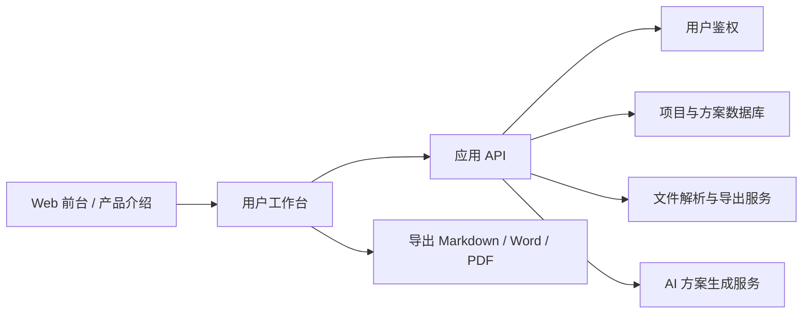
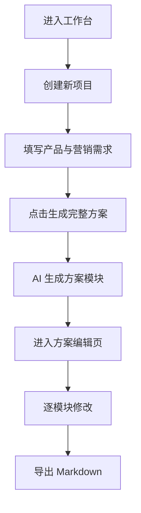
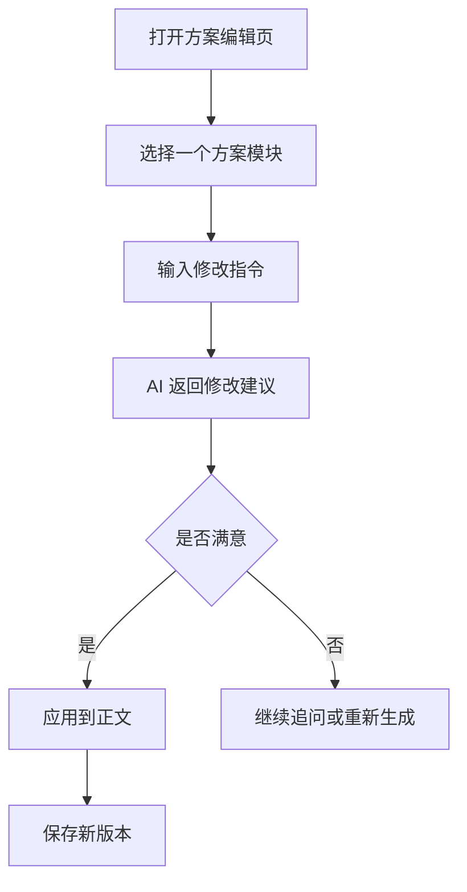
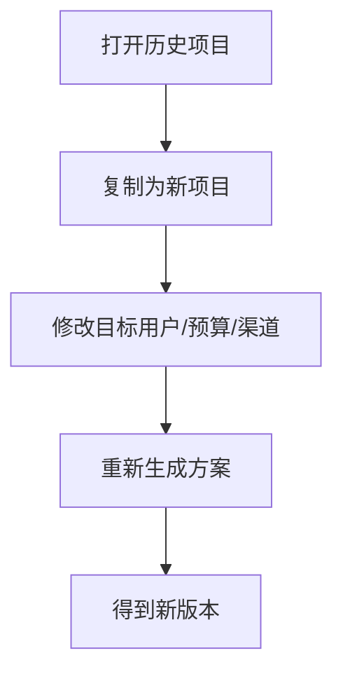

# PRD：AI 营销方案工作台

状态：Draft v0.1

创建日期：2026-07-14

目标：从零定义一个可落地开发的 AI 营销方案工作台，明确产品边界、页面结构、核心流程、数据模型、接口草案与开发顺序。

## 0. 参考与差异说明

本文档参考了 Datawhale easy-vibe 案例中的 PRD 写法与结构：先定义产品定位，再拆 MVP 范围、角色权限、页面架构、核心链路、后端模块、数据表、接口与开发节奏。

本项目与参考案例的关键差异：

| 维度 | 参考案例：AI 营销文案 SaaS | 本项目：AI 营销方案工作台 |
| --- | --- | --- |
| 核心产出 | 单条或多条营销文案 | 完整营销方案、传播策略、渠道打法、执行排期、预算建议、复盘指标 |
| 使用方式 | 选择文案类型后生成结果 | 围绕一个项目持续补充资料、生成多个方案模块、反复修改和导出 |
| 产品重心 | 文案生成 + 历史 + 套餐支付 | 项目管理 + 结构化方案生成 + AI 辅助修改 + 文档导出 |
| MVP 商业化 | 需要注册、套餐、支付闭环 | MVP 优先做可用工作台，支付和复杂后台可放二期 |
| 典型用户 | 内容运营、小团队、独立开发者 | 市场策划、品牌负责人、活动运营、创业团队、营销服务商 |

一句话定义：

做一个能把零散营销需求整理成完整方案，并支持 AI 生成、模块化编辑、版本管理和导出的营销策划工作台。

## 1. 项目定位

AI 营销方案工作台不是一个简单的“输入一句话，生成一段文案”的工具，而是一个面向真实营销策划流程的项目型工作台。

用户可以创建一个营销项目，填写产品背景、目标人群、营销目标、预算范围、活动周期、渠道偏好等信息。系统基于这些上下文生成一份结构完整的营销方案，并允许用户围绕每个模块继续追问、改写、补充、保存和导出。

### 1.1 产品愿景

让非专业营销人员也能快速产出一份结构完整、逻辑清晰、可执行的营销方案；让专业营销人员减少重复案头工作，把时间投入到判断、创意和客户沟通上。

### 1.2 核心价值

| 价值 | 描述 |
| --- | --- |
| 降低方案起草成本 | 用户不需要从空白文档开始，系统根据结构化信息自动生成初稿 |
| 提升方案完整度 | 通过固定模块确保方案覆盖背景、目标、策略、渠道、排期、预算、指标等关键内容 |
| 支持持续打磨 | 每个模块都可以单独让 AI 修改、扩写、压缩或换一种表达 |
| 沉淀项目资产 | 方案、历史版本、项目资料、生成记录都可以保存和复用 |
| 方便交付 | 支持 Markdown / Word / PDF / PPT 方向的导出规划，便于给老板、客户或团队展示 |

### 1.3 系统总览



### 1.4 技术选型建议

| 模块 | 建议方案 |
| --- | --- |
| 前端框架 | Next.js App Router |
| UI 实现 | React + Tailwind CSS + shadcn/ui 或自定义组件 |
| 用户鉴权 | Supabase Auth，MVP 也可先做本地 Demo 账号 |
| 数据库 | Supabase Postgres |
| 文件存储 | Supabase Storage 或对象存储 |
| AI 能力 | 后端统一封装模型调用，前端不直接暴露模型 Key |
| 文档导出 | MVP 先支持 Markdown，后续支持 docx / PDF / PPT |
| 部署 | Vercel / Cloudflare Pages + Supabase |

### 1.5 站点入口约定

| 入口 | 说明 |
| --- | --- |
| `www.xxx.com` | 产品官网、价值介绍、案例展示 |
| `app.xxx.com` | 用户创建项目、生成方案、编辑导出 |
| `admin.xxx.com` | 二期后台，查看用户、项目、生成量、模型成本 |

MVP 阶段可以只实现一个应用入口，例如 `app:/`，官网和后台先用轻量页面或暂不实现。

## 2. 目标用户与使用场景

### 2.1 目标用户

| 用户类型 | 需求 | 痛点 |
| --- | --- | --- |
| 创业者 / 独立开发者 | 为新产品写推广方案 | 不知道营销方案应该包含哪些部分 |
| 中小企业市场人员 | 快速产出活动方案、节日营销方案 | 时间紧，方案经常从旧文档复制修改 |
| 内容运营 / 新媒体运营 | 规划传播主题、渠道节奏、内容方向 | 想法零散，难以形成完整方案 |
| 营销服务商 / 乙方策划 | 给客户快速起草提案初稿 | 需要高频生成不同版本和不同风格 |
| 学生 / 学习者 | 学习营销策划结构 | 缺少真实方案模板和方法论框架 |

### 2.2 核心场景

1. 新产品上市推广方案
2. 节日营销活动方案
3. 线上裂变活动方案
4. 社媒传播方案
5. 品牌焕新传播方案
6. 线下活动招商或引流方案
7. 小红书 / 抖音 / 微信生态渠道打法方案
8. 已有方案的润色、补全和结构优化

### 2.3 核心目标

MVP 需要达到：

1. 用户能在 5 分钟内创建一个项目并生成第一版完整营销方案。
2. 用户能按模块查看、编辑、重新生成方案内容。
3. 用户能保存历史方案，后续继续修改。
4. 用户能一键复制或导出 Markdown 文档。
5. 产品能清晰展示 AI 正在做什么，失败时给出可恢复操作。

## 3. MVP 范围

### 3.1 第一版必须包含

| 模块 | 是否必须 | 说明 |
| --- | --- | --- |
| 项目创建 | 必须 | 输入项目名称、产品信息、目标用户、营销目标等 |
| 方案生成 | 必须 | 基于项目上下文生成完整营销方案 |
| 模块化编辑 | 必须 | 每个方案模块可单独编辑、重写、扩写、压缩 |
| AI 对话修改 | 必须 | 用户可对某个模块提出修改指令 |
| 历史记录 | 必须 | 保存项目和方案生成历史 |
| 导出能力 | 必须 | MVP 支持复制全文和导出 Markdown |
| 示例项目 | 必须 | 提供一个示例项目帮助用户理解输入方式 |
| 本地或云端保存 | 必须 | 根据开发阶段选择 localStorage 或数据库 |

### 3.2 第一版暂不做

1. 多人协作和团队空间
2. 完整支付订阅
3. 模板市场
4. 复杂审批流程
5. CRM 或广告投放平台集成
6. 自动抓取竞品数据
7. 多语言翻译链路
8. 自动生成完整 PPT 的高级排版能力

### 3.3 二期可以增强

1. 用户登录和云端同步
2. Word / PDF / PPT 导出
3. 方案模板库
4. 品牌资料库
5. 团队协作和评论
6. 套餐付费与用量限制
7. 后台运营数据看板
8. 行业案例库与竞品资料库

## 4. 角色与权限

| 角色 | 权限 |
| --- | --- |
| 游客 | 浏览官网、查看示例、体验有限次数生成 |
| 注册用户 | 创建项目、生成方案、保存历史、导出文档 |
| 高级用户（二期） | 使用高级模型、更多导出格式、更多项目数量 |
| 管理员（二期） | 查看用户、项目数量、生成记录、模型成本、异常日志 |

MVP 可以先不实现完整权限体系，但代码结构建议预留 `user_id`、`role`、`plan` 字段。

## 5. 信息架构与页面规划

MVP 建议定义为 `1 个主入口，7 个核心页面 / 视图`。

### 5.1 页面总览

| 编号 | 页面 | 路由建议 | 说明 |
| --- | --- | --- | --- |
| 1 | 工作台首页 | `app:/` | 项目列表、最近方案、创建入口 |
| 2 | 新建项目页 | `app:/projects/new` | 结构化填写营销需求 |
| 3 | 项目详情页 | `app:/projects/:id` | 查看项目背景、生成入口、历史方案 |
| 4 | 方案编辑页 | `app:/projects/:id/plans/:planId` | 模块化编辑和 AI 修改 |
| 5 | 历史版本页 | `app:/projects/:id/versions` | 查看不同版本、恢复、复制 |
| 6 | 导出预览页 | `app:/projects/:id/export` | 预览导出内容和格式 |
| 7 | 设置页 | `app:/settings` | 模型配置、导出偏好、账号设置 |

二期增加：

| 页面 | 路由建议 | 说明 |
| --- | --- | --- |
| 登录 / 注册 | `app:/login` / `app:/register` | 用户系统 |
| 模板库 | `app:/templates` | 不同营销场景模板 |
| 品牌资料库 | `app:/brand` | 品牌口吻、产品资料、竞品资料 |
| 后台首页 | `admin:/` | 运营数据与模型成本 |
| 用户管理 | `admin:/users` | 用户和套餐状态 |

## 6. 核心页面需求

### 6.1 工作台首页 `app:/`

核心功能：

1. 查看最近项目列表
2. 查看最近编辑的方案
3. 创建新项目
4. 打开示例项目
5. 搜索项目
6. 按状态筛选：草稿、已生成、已导出、已归档

页面信息：

| 区域 | 内容 |
| --- | --- |
| 顶部栏 | 产品名、创建按钮、设置入口 |
| 项目列表 | 项目名称、行业、更新时间、状态 |
| 快速入口 | 新产品上市、节日活动、社媒传播、线下活动等场景 |
| 空状态 | 引导用户创建第一个项目 |

### 6.2 新建项目页 `app:/projects/new`

用户需要填写的信息：

| 字段 | 类型 | 必填 | 说明 |
| --- | --- | --- | --- |
| 项目名称 | 文本 | 是 | 例如“AI 笔记工具上线推广” |
| 项目类型 | 选项 | 是 | 新品上市、活动推广、品牌传播、渠道增长等 |
| 产品 / 服务介绍 | 长文本 | 是 | 产品是什么、解决什么问题 |
| 目标用户 | 长文本 | 是 | 人群画像、使用场景、核心痛点 |
| 营销目标 | 多选 | 是 | 曝光、获客、转化、留存、招商、品牌认知 |
| 核心卖点 | 长文本 | 是 | 3-5 个关键卖点 |
| 活动周期 | 日期 / 文本 | 否 | 例如 4 周、春节前后、发布会前 30 天 |
| 预算范围 | 选项 / 数字 | 否 | 低预算、中预算、高预算或具体金额 |
| 渠道偏好 | 多选 | 否 | 小红书、抖音、公众号、社群、线下、广告投放等 |
| 风格偏好 | 选项 | 否 | 专业、年轻、犀利、温暖、高端、增长导向 |
| 补充资料 | 文件 / 文本 | 否 | 竞品资料、旧方案、产品说明 |

交互要求：

1. 表单分组，不要一次性堆满。
2. 必填项不足时不能生成方案。
3. 每个输入项提供简短 placeholder。
4. 支持保存草稿。
5. 支持从示例自动填充。

### 6.3 项目详情页 `app:/projects/:id`

核心功能：

1. 展示项目基础信息
2. 展示方案生成状态
3. 发起完整方案生成
4. 查看已有方案版本
5. 编辑项目资料
6. 进入方案编辑页

关键状态：

| 状态 | 说明 |
| --- | --- |
| 草稿 | 已创建项目，但还未生成方案 |
| 生成中 | AI 正在生成完整方案 |
| 已生成 | 已生成至少一个方案版本 |
| 生成失败 | 生成过程失败，可重试 |
| 已导出 | 用户已导出过方案 |

### 6.4 方案编辑页 `app:/projects/:id/plans/:planId`

这是产品最核心的页面。

方案建议拆成以下模块：

| 模块 | 内容 |
| --- | --- |
| 项目摘要 | 一句话概括项目目标和方案方向 |
| 背景分析 | 市场背景、用户痛点、机会点 |
| 目标设定 | 核心目标、阶段目标、量化指标 |
| 目标人群 | 用户画像、需求、触发场景 |
| 核心策略 | 总体传播策略和关键打法 |
| 创意主题 | Campaign 主题、主张、传播钩子 |
| 渠道规划 | 渠道选择、角色分工、内容方向 |
| 内容规划 | 内容栏目、选题示例、文案方向 |
| 执行排期 | 阶段拆分、关键节点、任务清单 |
| 预算建议 | 预算分配、低/中/高预算打法 |
| 数据指标 | 曝光、点击、转化、留存、ROI 等 |
| 风险预案 | 可能风险、应对方式 |
| 复盘建议 | 活动结束后的复盘维度 |

每个模块支持：

1. 手动编辑
2. AI 重写
3. AI 扩写
4. AI 缩短
5. AI 改成更专业 / 更活泼 / 更像提案稿
6. 复制单模块
7. 恢复上一个版本

右侧 AI 修改面板：

| 功能 | 说明 |
| --- | --- |
| 修改指令输入 | 用户输入“更适合小红书”“预算压到 1 万以内”等要求 |
| 快捷指令 | 更具体、更有创意、更像老板汇报、更像客户提案 |
| 对话历史 | 保留当前模块的修改过程 |
| 应用结果 | 用户确认后写回模块 |

### 6.5 历史版本页 `app:/projects/:id/versions`

核心功能：

1. 查看方案版本列表
2. 比较版本标题、生成时间、修改说明
3. 打开某个版本
4. 复制为新版本
5. 恢复为当前版本
6. 删除不需要的版本

版本命名规则：

1. 系统自动命名：`方案 v1`、`方案 v2`
2. 用户可手动改名：`老板汇报版`、`客户提案版`、`低预算执行版`

### 6.6 导出预览页 `app:/projects/:id/export`

MVP 导出能力：

1. 复制完整 Markdown
2. 下载 `.md` 文件
3. 复制纯文本

二期导出能力：

1. 导出 Word `.docx`
2. 导出 PDF
3. 导出 PPT 大纲
4. 选择导出模板
5. 控制是否包含预算、风险、执行清单等模块

### 6.7 设置页 `app:/settings`

MVP 可先做轻量设置：

1. 默认输出风格
2. 默认方案长度
3. 默认导出格式
4. API Key 配置状态（如果是本地自用版本）

商业化版本应由服务端管理模型 Key，不让普通用户填写平台级密钥。

## 7. 关键用户链路

### 7.1 首次生成链路



### 7.2 模块修改链路



### 7.3 复用旧项目链路



## 8. AI 生成策略

### 8.1 生成方式

MVP 建议采用“整体生成 + 模块单独修改”的方式：

1. 用户创建项目后，系统一次性生成完整方案。
2. 每个方案模块作为独立字段保存。
3. 用户修改某个模块时，只把项目上下文、当前模块和修改指令发给 AI。
4. 修改结果需要用户确认后再写入正文。

这样可以避免每次修改都重写整篇方案，也方便版本管理和导出。

### 8.2 Prompt 输入结构

完整方案生成时，后端应组装如下上下文：

```text
你是资深营销策划专家。请基于以下项目资料，生成一份结构完整、可执行的营销方案。

项目名称：
项目类型：
产品介绍：
目标用户：
营销目标：
核心卖点：
活动周期：
预算范围：
渠道偏好：
风格偏好：
补充资料：

请按固定模块输出：
1. 项目摘要
2. 背景分析
3. 目标设定
4. 目标人群
5. 核心策略
6. 创意主题
7. 渠道规划
8. 内容规划
9. 执行排期
10. 预算建议
11. 数据指标
12. 风险预案
13. 复盘建议
```

### 8.3 质量要求

AI 输出必须满足：

1. 不能只讲空泛概念，要给具体动作。
2. 渠道建议要和用户选择的渠道相关。
3. 预算建议要匹配预算范围。
4. 执行排期要能被团队照着推进。
5. 指标要尽量量化。
6. 不确定的信息要合理假设，并标明假设前提。
7. 避免过度承诺效果。

## 9. 后端模块设计

### 9.1 后端模块

| 模块 | 职责 |
| --- | --- |
| `auth` | 用户注册、登录、权限校验 |
| `project` | 项目创建、编辑、删除、查询 |
| `plan` | 方案生成、方案详情、版本管理 |
| `ai` | 模型调用、Prompt 组装、结果解析 |
| `export` | Markdown / Word / PDF 导出 |
| `file` | 上传资料、解析文本 |
| `analytics` | 生成次数、失败率、用量统计 |
| `admin` | 二期后台管理 |

MVP 如果先做单机或本地 Demo，可以把 `auth`、`admin`、`analytics` 简化。

### 9.2 数据表建议

#### `profiles`

```sql
profiles (
  id uuid primary key,
  email text unique,
  display_name text,
  role text default 'user',
  plan text default 'free',
  created_at timestamptz default now(),
  updated_at timestamptz default now()
)
```

#### `projects`

```sql
projects (
  id uuid primary key,
  user_id uuid references profiles(id),
  name text not null,
  project_type text not null,
  product_intro text not null,
  target_audience text not null,
  marketing_goals text[],
  selling_points text,
  campaign_period text,
  budget_range text,
  preferred_channels text[],
  tone text,
  extra_context text,
  status text default 'draft',
  created_at timestamptz default now(),
  updated_at timestamptz default now()
)
```

#### `plans`

```sql
plans (
  id uuid primary key,
  project_id uuid references projects(id),
  user_id uuid references profiles(id),
  title text not null,
  version_number int not null,
  status text default 'draft',
  summary text,
  background_analysis text,
  objectives text,
  target_persona text,
  core_strategy text,
  creative_theme text,
  channel_plan text,
  content_plan text,
  execution_timeline text,
  budget_plan text,
  metrics text,
  risk_plan text,
  review_plan text,
  created_at timestamptz default now(),
  updated_at timestamptz default now()
)
```

#### `ai_generation_records`

```sql
ai_generation_records (
  id uuid primary key,
  user_id uuid references profiles(id),
  project_id uuid references projects(id),
  plan_id uuid references plans(id),
  action_type text,
  input_payload jsonb,
  output_payload jsonb,
  model_name text,
  token_usage jsonb,
  status text,
  error_message text,
  created_at timestamptz default now()
)
```

#### `plan_module_versions`

```sql
plan_module_versions (
  id uuid primary key,
  plan_id uuid references plans(id),
  module_key text not null,
  old_content text,
  new_content text,
  instruction text,
  created_at timestamptz default now()
)
```

#### `uploaded_files`

```sql
uploaded_files (
  id uuid primary key,
  user_id uuid references profiles(id),
  project_id uuid references projects(id),
  file_name text,
  file_type text,
  file_url text,
  extracted_text text,
  created_at timestamptz default now()
)
```

## 10. 接口草案

### 10.1 项目接口

| 方法 | 路径 | 说明 |
| --- | --- | --- |
| `GET` | `/api/projects` | 获取项目列表 |
| `POST` | `/api/projects` | 创建项目 |
| `GET` | `/api/projects/:id` | 获取项目详情 |
| `PATCH` | `/api/projects/:id` | 更新项目 |
| `DELETE` | `/api/projects/:id` | 删除项目 |
| `POST` | `/api/projects/:id/duplicate` | 复制项目 |

### 10.2 方案接口

| 方法 | 路径 | 说明 |
| --- | --- | --- |
| `POST` | `/api/projects/:id/plans/generate` | 生成完整方案 |
| `GET` | `/api/projects/:id/plans` | 获取项目下的方案列表 |
| `GET` | `/api/plans/:planId` | 获取方案详情 |
| `PATCH` | `/api/plans/:planId` | 更新方案内容 |
| `POST` | `/api/plans/:planId/duplicate` | 复制为新版本 |
| `DELETE` | `/api/plans/:planId` | 删除方案 |

### 10.3 AI 修改接口

| 方法 | 路径 | 说明 |
| --- | --- | --- |
| `POST` | `/api/ai/rewrite-module` | 根据指令重写单个模块 |
| `POST` | `/api/ai/expand-module` | 扩写单个模块 |
| `POST` | `/api/ai/shorten-module` | 压缩单个模块 |
| `POST` | `/api/ai/suggest` | 给出优化建议，不直接改正文 |

### 10.4 导出接口

| 方法 | 路径 | 说明 |
| --- | --- | --- |
| `GET` | `/api/plans/:planId/export/markdown` | 导出 Markdown |
| `GET` | `/api/plans/:planId/export/text` | 导出纯文本 |
| `GET` | `/api/plans/:planId/export/docx` | 二期导出 Word |
| `GET` | `/api/plans/:planId/export/pdf` | 二期导出 PDF |

## 11. 前端组件规划

### 11.1 核心组件

| 组件 | 说明 |
| --- | --- |
| `ProjectList` | 项目列表 |
| `ProjectCard` | 单个项目卡片 |
| `ProjectForm` | 新建 / 编辑项目表单 |
| `PlanModuleEditor` | 单个方案模块编辑器 |
| `PlanOutline` | 方案目录导航 |
| `AIAssistantPanel` | AI 修改指令面板 |
| `VersionHistory` | 历史版本列表 |
| `ExportPreview` | 导出预览 |
| `LoadingState` | 生成中状态 |
| `ErrorState` | 失败与重试状态 |

### 11.2 工作台布局建议

方案编辑页建议采用三栏结构：

| 区域 | 宽度 | 内容 |
| --- | --- | --- |
| 左侧 | 220-280px | 方案目录、模块状态 |
| 中间 | 自适应 | 当前模块正文编辑 |
| 右侧 | 320-380px | AI 修改面板、快捷指令 |

移动端可以改为：

1. 顶部切换目录
2. 中间编辑正文
3. AI 面板以抽屉形式打开

## 12. 状态与异常处理

### 12.1 生成状态

| 状态 | 前端表现 |
| --- | --- |
| `idle` | 可以点击生成 |
| `validating` | 检查必填项 |
| `generating` | 显示生成进度和提示文案 |
| `success` | 展示方案内容 |
| `failed` | 显示错误原因和重试按钮 |
| `cancelled` | 用户取消生成 |

### 12.2 常见异常

| 异常 | 处理方式 |
| --- | --- |
| 必填信息缺失 | 高亮字段并提示 |
| 模型调用失败 | 保留用户输入，允许重试 |
| 输出格式解析失败 | 保存原始输出，并提示重新生成 |
| 网络中断 | 自动保存草稿 |
| 导出失败 | 提示重新导出，不影响方案内容 |
| 用户误删内容 | 支持撤销或从版本恢复 |

## 13. 非功能要求

1. 核心页面在桌面端和移动端都可用。
2. 项目表单输入应自动保存草稿。
3. 方案生成过程不能让用户误以为页面卡死。
4. AI 输出必须经过服务端过滤和结构化处理。
5. 用户只能访问自己的项目和方案。
6. 删除操作需要确认。
7. 文档导出要保证模块顺序稳定。
8. 生成失败必须记录日志，方便排查。
9. 模型 Key 不允许暴露到前端。
10. 数据库表结构要支持未来团队协作扩展。

## 14. 数据指标

MVP 需要关注：

| 指标 | 说明 |
| --- | --- |
| 新建项目数 | 用户是否开始使用产品 |
| 首次方案生成完成率 | 从创建项目到成功生成的比例 |
| 方案编辑次数 | 用户是否继续打磨 |
| 模块 AI 修改次数 | AI 辅助编辑是否有价值 |
| 导出次数 | 是否完成实际交付 |
| 生成失败率 | 模型和接口稳定性 |
| 平均生成耗时 | 用户等待体验 |

二期商业化关注：

1. 注册转化率
2. 免费到付费转化率
3. 人均项目数
4. 人均模型成本
5. 留存率
6. 导出格式偏好

## 15. 开发顺序建议

### 15.1 阶段一：本地可用 MVP

1. 搭建 Next.js 项目基础结构。
2. 完成工作台首页和项目列表。
3. 完成新建项目表单。
4. 使用 localStorage 保存项目草稿。
5. 实现方案编辑页静态结构。
6. 接入 AI 生成完整方案。
7. 实现模块级 AI 修改。
8. 实现 Markdown 导出。

### 15.2 阶段二：云端版本

1. 接入 Supabase Auth。
2. 建立项目、方案、生成记录数据表。
3. 把 localStorage 数据迁移为云端保存。
4. 增加历史版本。
5. 增加文件上传和资料解析。
6. 增加用量统计。

### 15.3 阶段三：产品化版本

1. 增加官网介绍页。
2. 增加模板库。
3. 增加 Word / PDF 导出。
4. 增加套餐和支付。
5. 增加后台运营页。
6. 增加团队协作。

## 16. 验收标准

MVP 完成时，应满足以下验收条件：

1. 用户可以创建一个完整项目。
2. 用户填写必填信息后，可以生成一份包含至少 10 个模块的营销方案。
3. 用户可以编辑任意模块。
4. 用户可以对任意模块发起 AI 修改，并把结果应用到正文。
5. 用户刷新页面后，项目和方案不丢失。
6. 用户可以复制完整方案。
7. 用户可以导出 Markdown 文件。
8. 生成失败时，用户不会丢失已填写内容。
9. 页面在 1440px 桌面和 390px 手机宽度下都可正常使用。
10. 代码中不暴露模型 API Key。

## 17. 待确认项

1. MVP 是否必须做登录注册，还是先做本地单用户版本？
2. 第一版是否需要接入 Supabase，还是先用 localStorage 快速跑通？
3. 导出格式第一版是否只做 Markdown？
4. 是否需要支持上传旧方案、产品介绍 PDF 或 Word 文档？
5. 方案模块是否固定为 13 个，还是允许用户自定义？
6. AI 生成是否使用一个统一模型，还是区分“快速生成”和“高质量生成”？
7. 产品是自用工具、课程作业，还是准备商业化上线？

## 18. 推荐 MVP 版本边界

为了最快做出可演示、可使用的版本，建议第一版这样收敛：

必须做：

1. 项目创建
2. 完整方案生成
3. 模块化编辑
4. 单模块 AI 修改
5. 本地保存
6. Markdown 导出

先不做：

1. 支付
2. 后台
3. 团队协作
4. 模板市场
5. 高级文件解析
6. 自动 PPT 排版

这个边界能保证项目既不像一个简单 Demo，也不会一开始就被账号、支付、后台和复杂导出拖慢。
